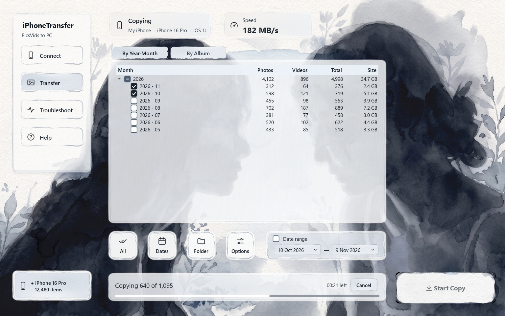
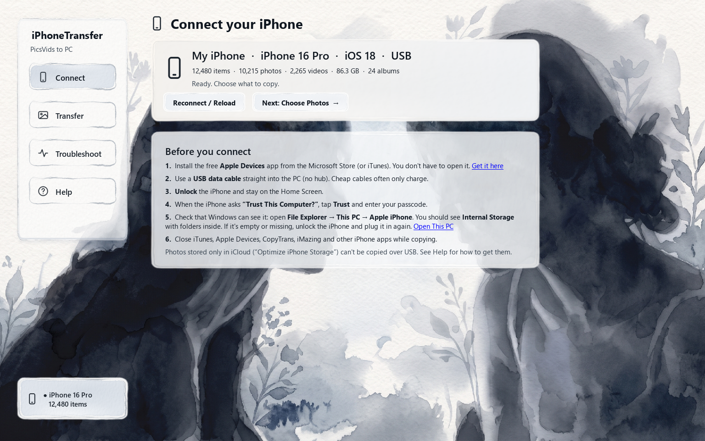
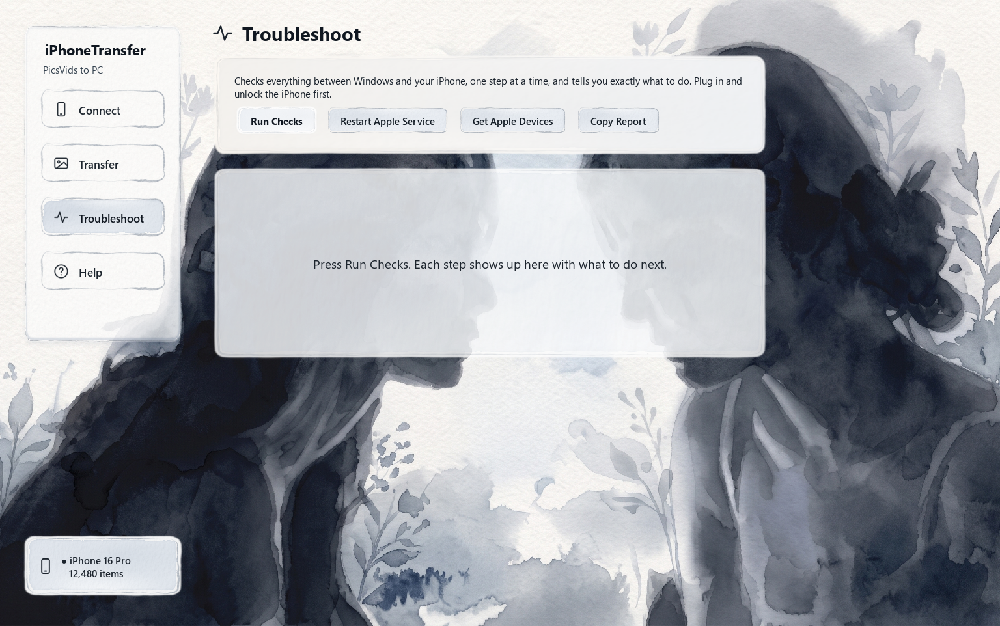
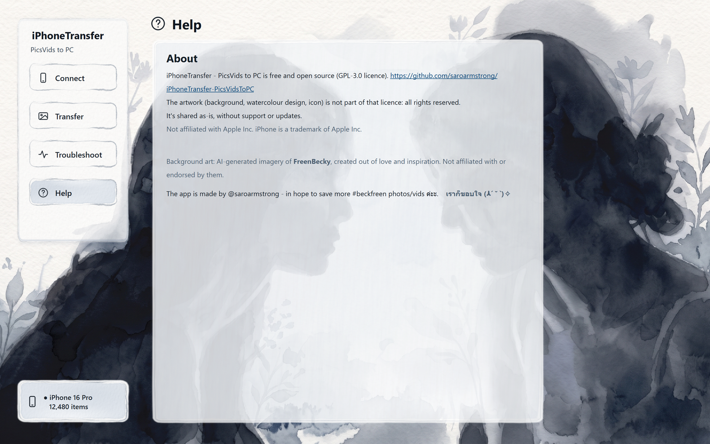

<p align="center"></p>

<h1 align="center">iPhoneTransfer</h1>

<p align="center">
Copy <b>all</b> your iPhone photos and videos to a Windows PC, fast, lossless and neatly organised.<br>
By <b>Year-Month</b> or by <b>Album</b>, with the date in every file name. Free and open source.
</p>

<p align="center">
<a href="../../releases/latest"><b>⬇ Download for Windows</b></a> ·
<a href="#connection-problems">Connection help</a> ·
<a href="#faq">FAQ</a>
</p>



## Why

Windows Explorer and the Photos app only show a flat `DCIM\100APPLE` mess, choke on big libraries
and know nothing about albums. This app talks to the iPhone the same way iTunes does, reads the iPhone's own
Photos library, and copies the original files straight to your PC.

| | |
|---|---|
| 🗂 **By Year-Month** | `D:\Photos\2026 Nov\20261108_14-03-18_IMG_6454.HEIC` |
| 📚 **By Album** | your albums, folders, shared albums and smart albums (Favorites, Videos, Screenshots…) |
| 🕑 **Date in the name** | date *added* to the iPhone (like "Recently Added") or date *taken* |
| ⚡ **Fast** | 150–200 MB/s over USB on recent iPhones, live speed and time left |
| ✅ **Lossless** | byte-for-byte originals (HEIC stays HEIC); optional checksum verification |
| 🔁 **Re-run any time** | skips what you already have; "only new since last copy"; pick an exact date range |
| 🩺 **Troubleshoot** | finds out *why* your iPhone won't connect and tells you what to do |
| 🔌 **Survives cable drops** | waits for the iPhone and resumes automatically |
| 🧳 **Huge libraries** | made for 100,000+ items; opens even huge libraries in seconds |
| ✏️ Extras | edited versions (`…_edited.JPG`), Live Photo videos, HEIC → JPG, tidy names for app downloads, photos/videos only |
| 🔒 **Private** | no account, no internet, no tracking: everything stays on your PC |

## What you need

- **Windows 10 or 11** (64-bit)
- **[Apple Devices](https://apps.microsoft.com/detail/9NP83LWLPZ9K)** from the Microsoft Store **or iTunes**.
  You never have to open it; it installs Apple's USB driver.
- **iPhone (or iPad) with iOS 16 or later**. Tested on iOS 18.
- A **USB data cable**

Not needed: Apple ID login, iCloud for Windows, jailbreak, or turning on file name extensions.

**Can't do:** copy photos that are *only in iCloud* ("Optimize iPhone Storage"). They're listed in a report
so you know which ones. It also can't delete photos from the iPhone; do that on the phone.

## Quick start

1. [Download](../../releases/latest) the **.zip**, unzip it anywhere (for example your Documents folder)
   and run **iPhoneTransfer.exe** inside. Nothing is installed.
   *Windows SmartScreen may say "Windows protected your PC". Click **More info → Run anyway**: the app isn't
   code-signed, but all the source code is here.*
2. Plug in the iPhone, **unlock** it, tap **Trust**. Check that **File Explorer → This PC → Apple iPhone**
   shows **Internal Storage** with folders inside. If it does, the app can connect.
3. **Connect** → **Transfer** → tick months or albums → **Start Copy**.

| Connect | Troubleshoot | Help |
|---|---|---|
|  |  |  |

## Connection problems

Run **Troubleshoot** in the app. It checks Windows, the Apple service, the USB driver, the cable, Trust,
iOS version, other apps holding the phone, power and the destination drive, and tells you the fix.
The most common fixes:

- **Install Apple Devices** (or iTunes), then restart the PC once.
- **Change the cable / port.** Plug straight into the PC, no hub. If the phone charges but isn't found, it's the cable.
- **Unlock before plugging in**, stay on the Home Screen, tap **Trust**.
- **Never get the Trust pop-up / tapped Don't Trust:** iPhone *Settings → General → Transfer or Reset iPhone →
  Reset → Reset Location & Privacy*, then plug in again.
- **Close iTunes / Apple Devices / CopyTrans / iMazing** while copying.
- **Restart the Apple service** (button in Troubleshoot), then the iPhone, then the PC.

> **No support.** iPhoneTransfer is a one-time, share-it-for-fun project. It's provided as-is, without
> support, fixes or updates. Issues and requests won't be answered. Troubleshoot and the in-app Help
> solve almost every problem.

## FAQ

**Is it really lossless?** Yes. Files are copied byte-for-byte. Turn on *Verify* to re-read every file from the
iPhone and compare SHA-256 checksums. Only the optional *HEIC → JPG* conversion changes files.

**My PC can't open HEIC.** Install Microsoft's free "HEIF Image Extensions", or tick *Convert HEIC photos to JPG*.

**Why are some names `IMG_123456.JPG`?** Only if you turn on *Rename app/web downloads*: photos saved from
Instagram/WhatsApp/browsers on another device have random names. They get `IMG_` + the iPhone's own ID instead.
Camera names (`IMG_1234`) never change.

**Does it upload anything?** No. The app never goes online.

**Mac?** Not yet. This is a Windows app.

## How it works

The app uses [pymobiledevice3](https://github.com/doronz88/pymobiledevice3) to talk to the iPhone over
Apple's USB protocol (usbmux → lockdown → AFC), the same service iTunes uses. The iPhone's Photos database
(`Photos.sqlite`, often 5–10 GB) is **not downloaded**. A small read-only SQLite VFS fetches only the pages of
the 4 tables it needs (~2%), concurrently, so even huge libraries open in seconds. Albums, dates and original
file names come from that database.

| file | what |
|---|---|
| `iphone_transfer/device.py` | connection, AFC pool, concurrent ranged reads |
| `iphone_transfer/remote_sqlite.py` | remote SQLite VFS + WAL overlay + B-tree prefetch |
| `iphone_transfer/library.py` | Photos.sqlite → assets / albums |
| `iphone_transfer/planner.py` | naming + folder layout |
| `iphone_transfer/copier.py` | parallel async copy, skip, verify, HEIC→JPG, progress |
| `iphone_transfer/doctor.py` | Troubleshoot checks |
| `iphone_transfer/gui.py` | PySide6 window |

### Build from source

```bat
py -3.12 -m venv .venv
.venv\Scripts\pip install -r requirements.txt
.venv\Scripts\python run_gui.py          &rem run
build.bat                                &rem tests + dist\iPhoneTransfer\iPhoneTransfer.exe
```

The watercolour artwork is not in this repository (see [ARTWORK-LICENSE.md](ARTWORK-LICENSE.md)), so a build
from source has a plain look. Everything else works the same.

## Credits

Artwork (background, watercolour design, icon): not covered by the GPL, all rights reserved. See
[ARTWORK-LICENSE.md](ARTWORK-LICENSE.md).

Background art: AI-generated imagery of **FreenBecky**, created out of love and inspiration. Not affiliated with or endorsed by them.


## License

Code: GPL-3.0 (see [LICENSE](LICENSE)), because it builds on pymobiledevice3 (GPL-3.0).
Artwork: all rights reserved (see [ARTWORK-LICENSE.md](ARTWORK-LICENSE.md)).
Not affiliated with or endorsed by Apple Inc. iPhone is a trademark of Apple Inc.

---

The app is made by @saroarmstrong - in hope to save more #beckfreen photos/vids ค่ะะ.    **เราก็ขอบใจ (ㅅ´ ˘ `)✧**
